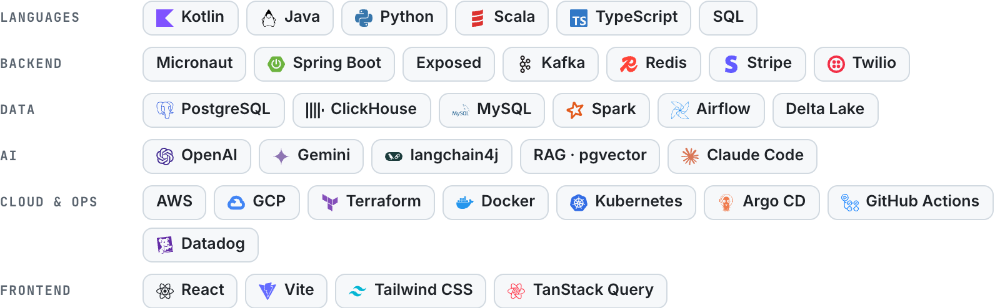

<b>💼 The 8 platforms I've shipped at Spartan</b>

 

| Platform | What I built |
| --- | --- |
| **Rideshare fleet operations** | Data-health fixes across 4 vendor integrations (Kafka, ClickHouse), and on-call alerting managed in Terraform |
| **AI-generated docs as shareable links** | The whole product in about 6 weeks: Kotlin API, React app, npm CLI, and Stripe billing for 4 plans |
| **CRM for SBA loans** | The CRM core, Twilio Video in 3 phases, and a lead-sync API |
| **AI startup validation** | Payments end to end with Stripe, plus email and sign-in flows on AWS SES |
| **Nutrition tracking** | The first backend features, and meal recognition with LLMs (langchain4j) |
| **Small-business lending** | Financial projections, Stripe billing, and a RAG chatbot |
| **Location data** | Airflow and Spark (Scala) pipelines on AWS EMR with Delta Lake |
| **Phone-charging kiosks** | The payout system and Stripe payment APIs |

**Software Engineer II at Bird** · 2021 – 2023, after an internship 
Payments for scooter rides: automated failed-payment clawback across Stripe, Braintree and Adyen (+0.5% revenue), worked 32,000 lost disputes (the lost rate fell ~20%), and built ride-end reports that helped win city permits.

<b>🧰 The whole stack</b>

 

<picture>
  <source media="(prefers-color-scheme: dark)" srcset="assets/stack-dark.png">
  
</picture>

<b>🎓 Education</b>

 

**B.S. Computer Science, minor in Mathematics** · California State University, Northridge · 2021 
Summa Cum Laude, 3.98 GPA, Dean's List

**Associate Degree for Transfer, Computer Science** · Moorpark College · 2019 · 4.0 GPA

On the side: **Agent Office**: your Claude Code sessions as little people in a 3D room. Open source soon.
